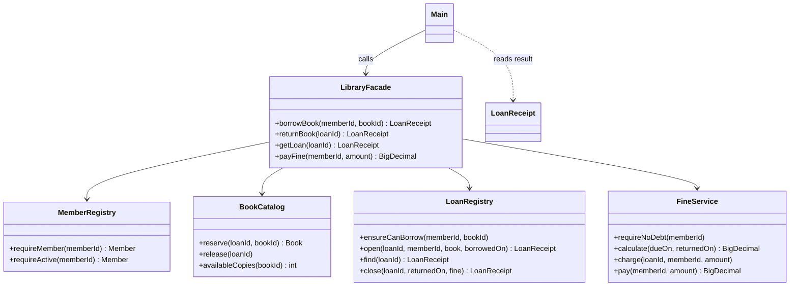

# Assignment 4 — Facade Pattern

## Topic

**Library Book Borrowing System** — borrowing and returning library books through a simple facade.

The client calls `borrowBook(memberId, bookId)` instead of coordinating membership checks, outstanding fines, borrowing limits, available copies, and loan creation itself. `returnBook(loanId)` records the return, calculates any overdue fine, and restores the available copy.

Requires **JDK 17 or newer**. No frameworks, build tools, external libraries, database, or network connection are required to run the application.

## Compile and run

Run from the repository root in PowerShell or a Unix shell:

```sh
javac -encoding UTF-8 -Xlint:all -Werror -d out src/library/*.java
java -cp out library.Main
```

The demonstration:

1. Borrows the only copy of *Clean Code* for member `S001`.
2. Rejects another member's request while that copy is unavailable.
3. Rejects an inactive member.
4. Returns the borrowed book and reads its updated loan record.
5. Borrows the released copy for member `S003`.
6. Rejects an unknown book ID.

Receipts show the borrowing date, due date, status, and fine. Dates follow the system clock. Returning a book immediately produces a `0.00 KZT` fine. Loan IDs are generated internally and returned in receipts.

## Facade components

| Role | Class | Responsibility |
| --- | --- | --- |
| Client | `Main` | Calls only `LibraryFacade` operations and reads immutable result data. |
| Facade | `LibraryFacade` | Coordinates the four subsystems in the required order and translates business failures into `LibraryException`. |
| Subsystem | `MemberRegistry` | Stores members, finds registered members, and rejects inactive memberships. |
| Subsystem | `BookCatalog` | Stores books and copy counts; reserves a copy by loan ID and releases it once. |
| Subsystem | `LoanRegistry` | Enforces a three-loan limit and prevents duplicate active loans for the same book; creates 14-day loans, stores history, and records returns. |
| Subsystem | `FineService` | Calculates overdue fines, records each loan's fine once, blocks borrowing for unpaid debt, and accepts fine payments. |
| Data | `Member`, `Book`, `LoanReceipt` | Immutable records for member data, catalog entries, and loan results. These are data objects, not extra subsystems. |
| Error | `LibraryException` | Gives the client a consistent business error while preserving the original cause. |

All four subsystems do real validation and state management. They cooperate through the facade: the catalog reserves the book used to create a loan; the loan's due date determines the fine; a recorded fine affects later borrowing eligibility; returning a loan releases its catalog reservation.



The client never constructs or calls a subsystem. The facade's public constructor creates the default subsystem configuration. A package-private constructor supports deterministic tests without exposing subsystem configuration in the public client API.

Subsystems have **no reference to `LibraryFacade`**. Their classes, constructors, and operations remain public, so an advanced client can use them directly. The `directSubsystemUse` regression test demonstrates this without creating a facade. The normal demonstration in `Main` uses only the facade.

## Coordination and failure handling

Borrowing follows this order:

```text
Check active membership
    -> Check unpaid fines
    -> Check loan limit and duplicate borrowing
    -> Reserve an available copy
    -> Create and store a 14-day loan
    -> Return an immutable receipt
```

If a business or coordination failure occurs during borrowing, the facade releases the reservation for that operation. Releasing an absent reservation has no effect, so earlier failures do not change stock. The original error is retained as the cause of `LibraryException`.

Returning follows this order:

```text
Find the loan
    -> Return its existing receipt if it was already returned
    -> Calculate the overdue fine
    -> Record the return
    -> Record the fine once
    -> Release the reserved copy
```

A repeated return keeps the original return date and fine. It cannot add extra copies or charge another fine. A return date earlier than the borrowing date is rejected before changing the loan, fine balance, or stock.

## Business rules and sample data

- Only registered, active members may borrow books.
- A member may have at most **3 active loans** and one active loan for a particular book ID.
- The loan period is **14 calendar days**.
- The fine is **100.00 KZT per overdue day**: `max(0, days between due date and return date) × 100.00`.
- Returning on the due date is free. A fine is assessed when an overdue book is returned.
- Outstanding assessed fines block new borrowing. Partial payments are allowed; borrowing becomes available once the balance reaches zero.
- Payments must be positive, have at most two decimal places, and cannot exceed the outstanding fine.
- Fine amounts use `BigDecimal` to avoid floating-point money calculations.

| Member ID | Sample name | Membership |
| --- | --- | --- |
| `S001` | Muhammad | Active |
| `S002` | Inactive member | Inactive |
| `S003` | Aruzhan | Active |

| Book ID | Title | Copies |
| --- | --- | --- |
| `B001` | Clean Code | 1 |
| `B002` | Head First Design Patterns | 2 |
| `B003` | Effective Java | 1 |
| `B004` | Refactoring | 1 |

This is a single-threaded, in-memory educational application. Each new `LibraryFacade()` starts with independent sample data. Fine payments update an in-memory balance; they do not transfer real money. State is not persisted between runs.

## Clean Code principles

1. **Meaningful names.** `borrowBook`, `returnBook`, `requireActive`, and `availableCopies` describe their purpose without needing code comments.
2. **Single responsibility.** `LibraryFacade` coordinates. Membership validation stays in `MemberRegistry`, copy management in `BookCatalog`, loan rules in `LoanRegistry`, and monetary rules in `FineService`.
3. **Small, focused methods.** Each subsystem operation performs a specific task, such as reserving a copy, opening a loan, calculating a fine, or paying a balance.
4. **Encapsulation and a small interface.** Subsystem fields are private. The facade exposes four business operations and returns immutable `LoanReceipt` data without returning subsystem instances or mutable collections.
5. **Do not repeat business rules.** The loan period and borrowing limit are named constants in `LoanRegistry`. The daily fine is defined once in `FineService`. The facade delegates these rules instead of duplicating them.
6. **Explicit error handling.** Business failures produce informative `LibraryException` messages with their original causes. Borrowing releases reservations after a failure; repeated returns and releases do not repeat side effects.
7. **Testable dependencies.** Dependencies are explicit constructor parameters internally. Tests provide fixed clocks and known subsystem state, allowing exact overdue-date and balance checks without waiting for real time to pass.

All Java source files are written without comments.

## Verification

```sh
javac -encoding UTF-8 -Xlint:all -Werror -d out src/library/*.java test/library/*.java
java -cp out library.LibraryFacadeTest
java -cp out library.Main
```

The test runner requires no test framework and throws an `AssertionError` on failure. It does not depend on Java's optional `-ea` flag. It covers **18 scenarios**, including unavailable copies, inactive members, unknown IDs, duplicate borrowing, borrowing limits, successful returns, repeated returns, overdue fines, partial and full payments, invalid payments, rollback after a coordination failure, invalid return dates, and direct use of the subsystems.

The overdue tests use fixed clocks: a book borrowed on October 1, 2026 is due on October 15. Returning it on October 18 produces exactly `300.00 KZT` of debt. The final test output is:

```text
All 18 tests passed.
```

GitHub Actions compiles with warnings treated as errors, runs the tests, and runs the demonstration on JDK 17 for pushes and pull requests.

## Why this is Facade

Facade is a **structural design pattern** that provides a simplified interface to a complex subsystem. Here, the complexity is coordinating four separate responsibilities in the right order. The facade reduces what a normal client needs to know while preserving direct access to the subsystem for advanced clients.

The facade is not a replacement for the subsystem: it delegates the actual rules and state changes. It also does more than rename a single method: one borrowing call coordinates membership, debt, loan eligibility, stock reservation, and record creation.

Unlike Bridge in Assignment 3, this project does not separate two independently growing class hierarchies. Its purpose is to give the client a simple entry point to an existing set of cooperating classes. An Adapter would make an incompatible interface usable; this facade simplifies several already usable interfaces.
